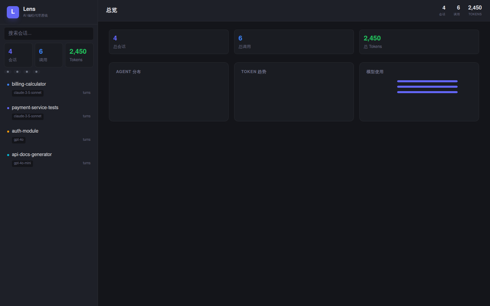
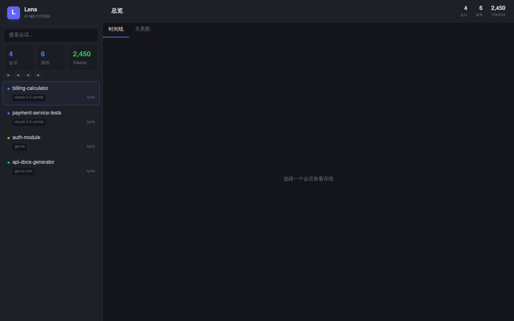
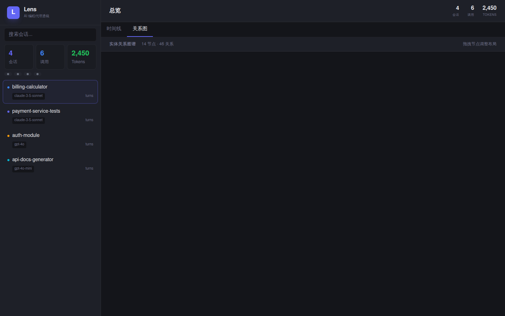

# Lens · 透镜

**[English](#english) | [中文](#中文)**

<p align="center">
  <strong>Turn AI coding agent dialogues into interactive panoramas.</strong><br/>
  <sub>将 AI 编程代理的对话流变为可视化全景。</sub>
</p>

<p align="center">
  <a href="https://gitcode.com/badhope/lens"></a>
  <a href="https://gitee.com/badhope/lens"></a>
  <a href="https://github.com/X33834/lens"></a>
  <a href="https://github.com/Morningstar202604/lens"></a>
  
  
  
</p>

---

<span id="english"></span>

## English

**Lens** is a local-first, transparent HTTP proxy that records the complete communication between AI coding agents (OpenCode, Codex, Claude Code, Trae, Kimi Code) and LLM APIs — then turns those dialogues into interactive visualizations.

It uses **your agent's own API keys**. Lens just passively watches, records, and visualizes. No configuration changes needed in your agent.

<a href="docs/screenshots/dashboard.png"></a>

### How It Works

```
┌─────────────┐     HTTP/HTTPS      ┌──────────┐      forward       ┌────────────┐
│ AI Agent    │ ──────────────────▶ │  Lens    │ ────────────────▶  │ LLM API    │
│ (Codex,     │ ◀────────────────── │  Proxy   │ ◀────────────────  │ (OpenAI,   │
│  Claude...) │    (with MITM TLS)  │  :9999   │                    │  Anthropic)│
└─────────────┘                     └────┬─────┘                    └────────────┘
                                         │
                                         ▼ record
                                   ┌──────────┐      ┌──────────┐
                                   │  SQLite  │ ───▶ │  Web UI  │
                                   │  lens.db │      │  /api/*  │
                                   └──────────┘      └──────────┘
```

### Features

- **Zero-config agent integration** — Set one environment variable, agent works unchanged
- **Multi-agent recognition** — Auto-detects OpenCode, Codex, Claude Code, Trae, Kimi Code
- **HTTPS interception** — Full TLS MITM with dynamic certificate signing
- **Conversation Timeline** — Full message history with expandable tool calls
- **Stats Dashboard** — Token usage, agent distribution, model comparison
- **Knowledge Graph** — Entity extraction (files, functions, topics) with force-directed layout
- **Cross-platform** — macOS, Linux, Windows (Tauri v2 desktop)

### Quick Start

```bash
# Build
cargo build --release

# Start proxy (in one terminal)
./target/release/lens proxy

# Start web viewer (in another terminal)
./target/release/lens view

# In your agent's terminal:
export HTTP_PROXY=http://127.0.0.1:9999
export HTTPS_PROXY=http://127.0.0.1:9999
# ... use your agent as normal
```

### Platform Proxy Setup

**VS Code** (`settings.json`):
```json
{
  "http.proxy": "http://127.0.0.1:9999"
}
```

**Cursor** (Settings → Network → Proxy):
```
http://127.0.0.1:9999
```

**Terminal agents** (Codex, Claude Code, etc.):
```bash
export HTTP_PROXY=http://127.0.0.1:9999
export HTTPS_PROXY=http://127.0.0.1:9999
```

### Screenshots

| Dashboard | Timeline | Graph |
|-----------|----------|-------|
| <a href="docs/screenshots/dashboard.png"></a> | <a href="docs/screenshots/timeline.png"></a> | <a href="docs/screenshots/graph.png"></a> |

### Architecture

```
lens/
├── src/
│   ├── proxy/          # HTTP/HTTPS transparent proxy
│   │   ├── server.rs   # Entry & dispatch
│   │   ├── connect.rs  # HTTPS CONNECT + MITM
│   │   ├── http.rs     # HTTP proxy handler
│   │   ├── io.rs       # I/O helpers
│   │   ├── cert.rs     # TLS cert management
│   │   ├── parser.rs   # LLM request/response parser
│   │   └── request.rs  # Agent detection
│   ├── engine/
│   │   ├── store.rs    # SQLite storage
│   │   ├── graph.rs    # Knowledge graph builder
│   │   └── summary.rs  # Conversation summarization
│   ├── adapter/        # Agent type detection
│   └── web/            # Axum REST API server
├── frontend/           # Preact + Vite + Tailwind
│   ├── src/components/ # UI components
│   └── src/lib/        # API client, types
└── web/                # Built frontend assets
```

### License

MIT

---

<span id="中文"></span>

## 中文

**Lens（透镜）** 是一个本地优先的透明 HTTP 代理，完整录制 AI 编程代理（OpenCode、Codex、Claude Code、Trae、Kimi Code）与 LLM API 之间的通信，并将其转化为交互式可视化。

它使用 **你自己的 API 密钥**。Lens 只是被动地观察、记录和可视化，无需修改你的 agent 配置。

### 工作原理

Lens 作为本地代理运行在 `127.0.0.1:9999`，拦截 HTTP/HTTPS 流量（包括 TLS MITM），解析 LLM 对话结构，存入 SQLite 数据库，并通过 Web 面板提供可视化。

### 特性

- **零配置集成** — 设置一个环境变量，agent 无需改动
- **多代理识别** — 自动识别 OpenCode、Codex、Claude Code、Trae、Kimi Code
- **HTTPS 拦截** — 完整的 TLS MITM + 动态证书签发
- **对话时间线** — 完整消息历史，可折叠的工具调用
- **统计面板** — Token 用量、代理分布、模型对比
- **知识图谱** — 自动提取实体（文件、函数、话题），力导向布局
- **跨平台** — macOS、Linux、Windows（基于 Tauri v2）

### 快速开始

```bash
# 构建
cargo build --release

# 启动代理（第一个终端）
./target/release/lens proxy

# 启动可视化面板（第二个终端）
./target/release/lens view

# 在你的 agent 终端中：
export HTTP_PROXY=http://127.0.0.1:9999
export HTTPS_PROXY=http://127.0.0.1:9999
# ... 正常使用你的 agent
```

### 各平台代理设置

**VS Code**（`settings.json`）：
```json
{
  "http.proxy": "http://127.0.0.1:9999"
}
```

**Cursor**（设置 → 网络 → 代理）：
```
http://127.0.0.1:9999
```

**终端 agent**（Codex、Claude Code 等）：
```bash
export HTTP_PROXY=http://127.0.0.1:9999
export HTTPS_PROXY=http://127.0.0.1:9999
```

### 项目结构

```
lens/
├── src/
│   ├── proxy/          # HTTP/HTTPS 透明代理
│   │   ├── server.rs   # 入口 & 分发
│   │   ├── connect.rs  # HTTPS CONNECT + MITM
│   │   ├── http.rs     # HTTP 代理处理
│   │   ├── io.rs       # I/O 辅助
│   │   ├── cert.rs     # TLS 证书管理
│   │   ├── parser.rs   # LLM 请求/响应解析
│   │   └── request.rs  # Agent 检测
│   ├── engine/
│   │   ├── store.rs    # SQLite 存储
│   │   ├── graph.rs    # 知识图谱构建
│   │   └── summary.rs  # 对话总结
│   ├── adapter/        # Agent 类型检测
│   └── web/            # Axum REST API 服务器
├── frontend/           # Preact + Vite + Tailwind
│   ├── src/components/ # UI 组件
│   └── src/lib/        # API 客户端、类型
└── web/                # 构建后的前端资源
```

### 许可证

MIT
